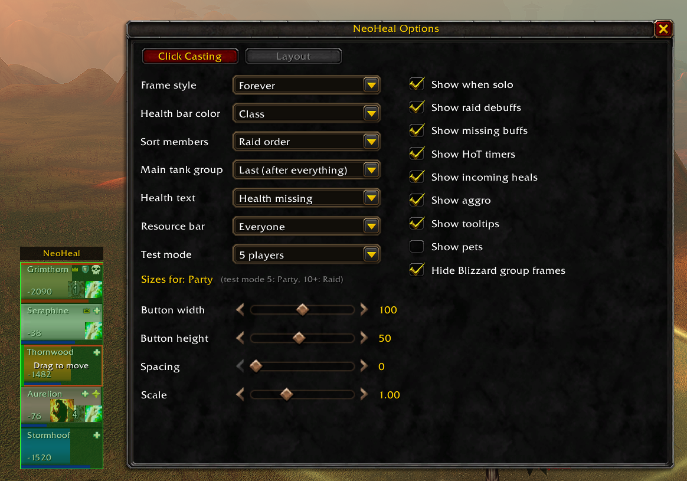
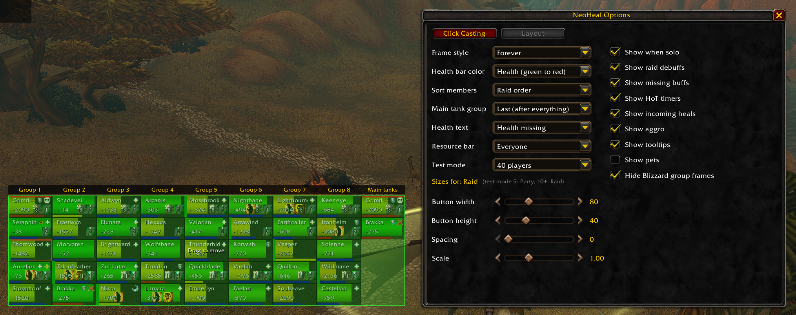
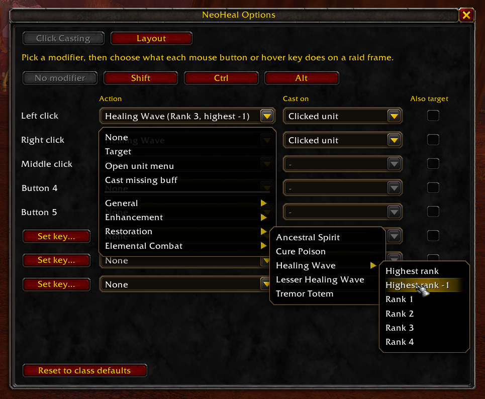

# Features

## Screenshots

Test mode with 5 players, with the Layout page of the options:

Test mode with 40 players: eight groups and the main tank group, health colors
from green to red, and the raid size preset:

## Opening the options

- `/neoheal` opens or closes the options window (Escape closes it too).
- The NeoHeal icon in the addon compartment, the addon list beside the minimap,
  does the same: one click opens, another closes.
- Esc > Options > AddOns > NeoHeal has a button that opens the same window.
- The window title shows the version you run, read from the addon's `.toc`:
  "NeoHeal Options (0.6.0)". An addon the client reports no version for keeps
  the plain title.
- `/neoheal debug` prints which HoT and raid marker data the game hides right
  now. Run it in combat to see what Forever hides.
- `/neoheal clicks` turns click debugging on or off: every click on a frame
  prints which mouse button arrived and what it is bound to.

While the options window is open the frames are in **move mode**: a green
overlay that you can drag. Outside move mode, **Ctrl + drag** a title ("NeoHeal"
bar, a "Group N" label in a raid, or the "Target" and "Focus" labels) to move
the frames. Nothing moves in
combat.

## The frames

One column per raid group (1–8). Only groups with members take up room, so a
party shows one column and a full raid eight. The frames are pinned by their
top-left corner and grow to the right and down.

- **Solo or party:** one "NeoHeal" title bar above all frames.
- **Raid:** a label above every column ("Group 1", "Main tanks", "Pets").
- **Main tank group** (optional): raid members marked as Main Tank, before group
  1 or after everything. They also stay in their own group.
- **Pets** (optional): their own column(s) after the groups.
- **Target and focus** (optional, "Show target frame" and "Show focus frame"):
  see below.

### Target and focus frames

One frame for your target and one for your focus, so you can heal someone who
isn't in your group, or without looking for them in the raid. They look and
click exactly like the group frames: the same bindings, hover keys, tooltip,
heal prediction, HoTs, debuffs, range fade, missing buffs, and the res on a dead
member. Each shows only while its unit exists and is friendly, and follows a
new target or focus, also in combat.

They sit above the frames, clear of the title bar and group labels: the target
on the left, the focus to its right, each with a small "Target" or "Focus"
label that Ctrl-drags the frames like the other titles. They have the button
size of the size preset in use and move with the frames. Only the group frames
are kept on screen, so with those against the top of the screen these two may
end up off it (not checked in game). The target frame never shows the white
"your target" border; the focus frame does when your focus is your target. Test
mode shows both, with fake members, while their option is on.

Showing them uses the game's macro conditions `[@target,help]` and
`[@focus,help]`; that these and the focus work on Forever isn't checked in game
yet.

They fade out of range by the spell your left click casts on them, because the
game's own range check answers only for party and raid members, where these
frames are exactly the ones that need it
([forever-api.md](forever-api.md) section 2). The spell is the one an
unmodified left click casts, so the fade doesn't change while you hold a
modifier. When that click isn't a spell on the unit itself (a menu, the missing
buff), or the game can't judge that spell's range, the frame stays at full alpha
instead of fading on a guess. Both are unchecked in game: whether Forever hides
the range answer in combat, and whether it accepts every unit for it.

### What one frame shows

| Where | What |
| --- | --- |
| Health bar | Class colour (pets green), or green → yellow → red by health |
| After the health fill | Incoming heals (light green), then the heal prediction of your left click (lighter green, or blue for a shield; frame under the mouse only), then shields/absorbs (pale blue) |
| Empty part of health bar | Turns red below 35% health |
| Bottom strip | Resource bar (mana/rage/energy) for everyone, healers only, or nobody |
| Top left | Name, cut off at the icons (no "...") |
| Top right | Raid marker, role icon (main tank / main assist / tank / healer), leader crown or assist flag |
| Bottom left | Health text: percentage, health missing (`-2340`), or off. "Dead" / "Offline" |
| Bottom right | Up to 3 of **your own** HoTs with a cooldown swipe and optional countdown |
| Bottom right, 3rd slot | Out of combat: grey icon with red edge = this member lacks your class's raid buff, or has 10% or less of it left |
| Centre, below the name | Up to 2 raid debuffs (e.g. boss debuffs), 1.5× the HoT icon size |
| Centre, over the health bar | Blue "OOM" on a healer at 20% mana or less, in and out of combat |
| Centre | Ready check answer, incoming resurrection, or incoming summon |
| Left edge | Dispel strip in the debuff type's colour, only for types **you** can remove (Magic blue, Curse purple, Disease brown, Poison green) |
| Top edge | Red line while the member has aggro |
| Border | White: your current target (not on the target frame). Red: who your hostile target is targeting |
| Whole frame | Fades to 40% when out of range |

A **healer**, for the resource bar's "Healers only" and for the "OOM" text, is a
member with the assigned Healer role, or one without a role whose class is
Priest, Druid, Paladin or Shaman. The two use that one rule, so the text shows
whatever the resource-bar setting says.

The "OOM" text shows at 20% mana or less and never on a dead or offline member.
It reads the mana bar, so a shapeshifted druid shows their own mana rather than
the form's bar. In combat the mana behind it may be secret; a colour curve gives
the text its alpha, so it shows and hides without the addon comparing anything.

Not checked in game yet: whether the client accepts a secret colour on the text
(hidden if not), and whether a shapeshifted druid's mana is readable at all.

HoTs tracked per class: Priest Renew + Power Word: Shield, Druid Rejuvenation +
Regrowth. Other classes show no HoT icons.

Missing buffs per class: Priest Fortitude (+ Divine Spirit if talented), Druid
Mark of the Wild, Mage Arcane Intellect (not for warriors and rogues). Paladin
blessings are left out on purpose.

A buff that is running out counts as missing: 10% or less of its full duration
left, so 3 minutes of a 30-minute buff and 6 of a 1-hour one. You can rebuff
before the pull instead of losing it in the fight. The single and the group
version count as one buff: Prayer of Fortitude with time left covers a Power
Word: Fortitude that is running out. The icon appears when a buff starts running
out, without waiting for any other change on the member. Not checked in the game
yet.

## Click casting (per character)

Pick a modifier (none, Shift, Ctrl, Alt), then choose per mouse button what a
click does. Five mouse buttons plus three **hover keys**: keyboard keys that
"click" the frame under the mouse (left click the key button to set, right click
to clear). A hover key only takes its key over while it has an action on at
least one modifier. Setting a hover key refuses a key that moves your character
(forward, back, turn, strafe, jump, sit or descend, pitch, mouse steer): it says
so in red and waits for another key. A hover key that moves you anyway (set
before this check, or bound to movement in the game's key bindings since) keeps
its action but isn't bound: the tooltip leaves it out, and its button reads
"W (moves you)". Unbind the movement and it works again.

While a button reads "Press a key", your keys go to it instead of the game. A key
sets it and Escape leaves it as it was. Anything that redraws the binding rows
ends the wait: clearing the key, setting another hover key, picking a modifier or
an action, resetting the bindings, or a change the game makes. So do switching
page, closing the window and starting combat. The button then shows its key again
and your keys do what they always do. What leaves the rows as they are keeps the
wait reading "Press a key": a "cast on" choice, ticking "Also target", dragging or
clicking the window, or opening and closing a menu without a choice.

Actions:

- **None**
- **Target** and **Open unit menu**. On plain left and right click these are the
  game's own. Anywhere else (with a modifier, on middle click or buttons 4/5, or
  on a hover key) Blizzard's click bindings would drop them, so NeoHeal does them
  itself:
  - Target becomes a `/target` macro, so a spell waiting for a target isn't cast
    on the clicked unit.
  - NeoHeal opens the menu itself. An entry that needs Blizzard's secure code,
    such as Set Focus, may be blocked, and no menu opens while a spell waits for
    a target. On the target and focus frames NeoHeal opens the menu Blizzard's
    own frames open there: the focus menu on the focus frame, and on the target
    frame one picked from what your target is (you, a pet, a party or raid
    member, a player outside your group, or an NPC). That Forever's client
    knows those menus isn't checked in game yet.
- **Cast missing buff**: casts the buff whose icon shows on that frame. In a raid
  it uses the group version if you know it and carry the reagent, but only for a
  party or raid member: that version is assumed to land on your own group only,
  so on the target or focus frame of someone outside it the click casts the
  single version instead. Out of combat only, and not during a ready check.
  Otherwise the click does nothing and explains why in red at the top of the
  screen.
- **A spell** from your spellbook: "Highest rank" (follows new ranks you learn),
  "Highest rank -1" (the rank below that, also follows; useful as a cheaper,
  mana-efficient heal), or a fixed rank. The rank choices show only for spells
  with two or more ranks.

Per binding:

- **Cast on**: the clicked unit, its target, or its target's target.
- **Also target**: cast *and* target the unit in one click (spells only).

**Tooltip:** hovering a frame shows the unit tooltip with your bindings below
it: one line per bound button, such as "Left click — Flash Heal", including
middle click, buttons 4/5 and hover keys that have a key. Hold Shift, Ctrl or
Alt and the tooltip switches to that modifier's bindings, under its name. Holding
two modifiers at once shows none, because such a click does nothing, not even a
res or a missing buff. Bindings that don't go to the clicked unit name their
target, e.g. "Flash Heal (Unit's target)". The tooltip shows the bindings as
they work right now: a binding you change in combat appears once it takes
effect, when combat ends. One thing it doesn't show: on a dead friendly member a
spell click casts your res instead (see Auto-resurrect), while the tooltip still
lists the spells. The "Show tooltips" option switches the whole tooltip off.

After a learned spell the tooltip shows how much it heals or absorbs, for exactly
the rank the click casts:

- A heal shows its range in green, e.g. "Healing Wave 237-280". This includes
  Chain Heal (its first target) and Holy Shock (its healing).
- A heal over time shows its total, and Regrowth its direct heal.
- A shield shows its absorb in light blue, e.g. "Power Word: Shield 942 absorb".

The numbers come from the spell's own description, so it's not known yet whether
they include +healing from gear. In game on 2026-10-04 there was no +healing to
compare (`GetSpellBonusHealing()` returned 0). Only English descriptions are read.

Some spells show no number:

- Damage spells and cures.
- Tranquility and Lay on Hands, whose descriptions give no healing range.
- A spell whose data the game hasn't loaded yet: its description is empty until
  then. NeoHeal doesn't ask the game to load it; spells in your spellbook are
  normally loaded. Not checked in game.

**Heal prediction:** the frame under your mouse shows on its health bar how
much your left click would heal, with the modifiers you hold right now. It sits
right after the incoming heals: the lowest amount, which the heal always reaches,
in a lighter green, and the rest of the range up to the highest amount, which it
may reach, in the same green but fainter. Press or release Shift, Ctrl or
Alt and it switches to that modifier's left click. It uses the same numbers as
the tooltip, so the same limits apply (English descriptions, +healing not known
yet), and a heal over time shows its total. It works in combat too (seen in
game on 2026-10-04): the amounts are NeoHeal's own numbers, the bar places them
against the member's (hidden) maximum health, and the game still gives the spell
description then.

A shield on the left click shows its absorb instead, in the blue of its tooltip
amount, where the shield will go. Power Word: Shield shows on any member's frame.
It doesn't show on a member with Weakened Soul, whoever's shield left it, as the
cast would fail, nor on one whose Power Word: Shield is still up (it outlasts
Weakened Soul), as a new one wouldn't add to it. A shield other than Power Word:
Shield is treated as one that only goes on you, such as a Mage's Ice Barrier: it
shows only on a frame that shows you (your own frame, your own raid frame, or the
target or focus frame while it shows you), and nowhere else. Where the game hides
whether a frame is you, it shows nothing there. Such a shield doesn't show while
its own shield is still up on you, as a new one wouldn't add to it. It does show
with Weakened Soul or a Power Word: Shield on you, whoever's, as those only stop a
new Power Word: Shield. In combat the game hides auras from addons, so none of
this can be told and no shield prediction shows (seen in game on 2026-10-04, as
was the shield prediction out of combat). That shields other than Power Word:
Shield only go on you, which absorbs beside it read as shields, and whether the
game hides whether a raid frame is you are not checked in game.

Nothing shows when the left click:

- does something other than cast a spell (Target, menu, missing buff), or casts on
  the unit's target or target's target;
- casts a spell you haven't learned, or a spell without a readable amount;
- would hit a dead member (the click casts your res then) or an offline one.

Turn it off with "Show left-click heal prediction" (Layout page). In test mode the
fifth fake member shows it, as if under the mouse.

**Auto-resurrect:** a spell click on a dead friendly member casts your res
spell instead (Priest Resurrection, Paladin Redemption, Shaman Ancestral Spirit,
Druid Rebirth). Target and menu clicks keep working.

**A click casts something else?** The game's own Click Casting window
(`/run ToggleClickBindingFrame()`) keeps bindings of its own. A spell or macro
bound there on the same mouse button and modifiers is cast instead of NeoHeal's
binding. `/neoheal clicks` prints what NeoHeal has bound for the
click; if that is right, remove the binding in the Click Casting window.

**Reset to class defaults** restores the starting bindings: Ctrl+left = Target
and Ctrl+right = menu, plus the class's main heals and cures where learned.
Plain left and right click start as Target and menu too, unless a class heal
takes them: left click for Priest, Druid, Paladin and Shaman, right click for
Priest and Druid.

## Layout options (account-wide)

Left column:

| Option | Choices |
| --- | --- |
| Frame style | Forever (flat, dark) · Classic (stone, tooltip border) |
| Health bar color | Class · Health (green to red) |
| Sort members | Raid order · By name · Tanks, healers, damage · By class |
| Main tank group | None · First · Last |
| Health text | Percentage · Health missing · Off |
| Resource bar | Everyone · Healers only · Off |
| Test mode | Off · 5 · 10 · 25 · 40 fake players (lasts while the window is open) |
| Button width / height, spacing, scale | Saved **per size preset** |

**Size presets:** sizes, scale and position are kept separately for *Party*
(solo and party) and *Raid*. The sliders edit the preset in use. In test mode,
5 players edits Party and 10+ edits Raid.

Right column (checkboxes): show when solo, raid debuffs, missing buffs, HoT
timers, incoming heals, left-click heal prediction, aggro, low mana, tooltips,
pets, target frame, focus frame (both off by default), hide Blizzard group
frames (turning this off again needs a `/reload`).

Changes made in combat are applied when combat ends. The window shows a red
notice while that is the case.
